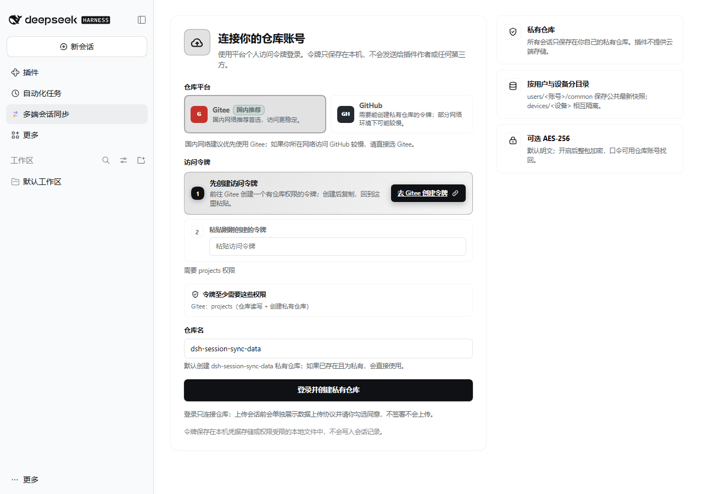
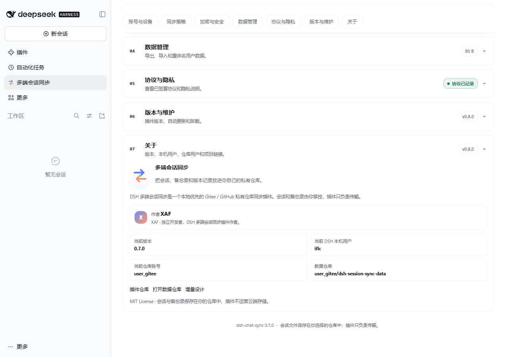
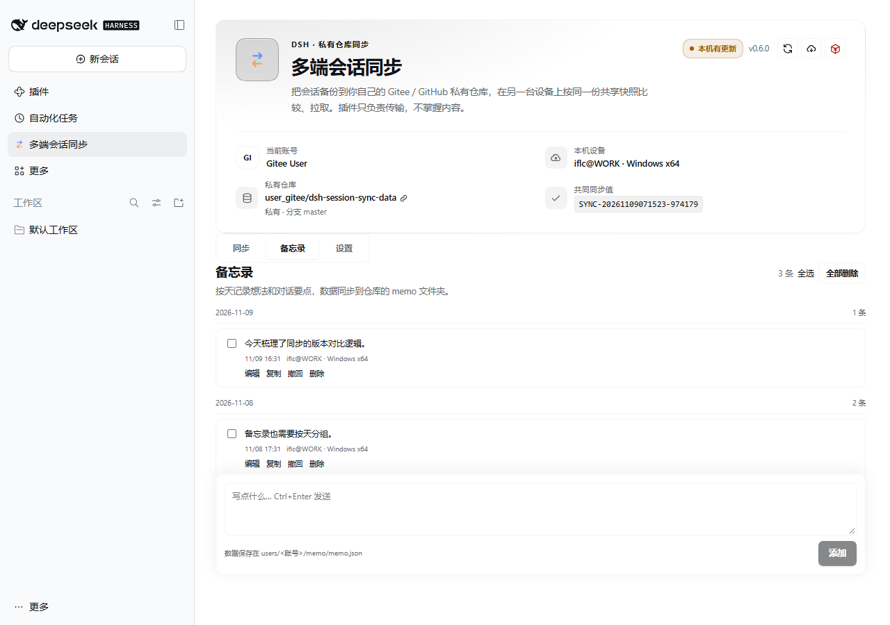

# DSH Multi-device Session Sync

> Package: `dsh-chat-syncer`

Back up DeepSeek Harness (DSH) sessions to your own **private Gitee / GitHub repository**, compare one shared latest snapshot, and pull it on another device. The plugin only packages, pushes, and pulls on this machine; it runs no cloud service and does not own your content.

Gitee is the default platform. GitHub is selectable. Sign-in uses a personal access token (PAT); no Git client and no account password are needed.







## Highlights

- Private repository first; no plugin-operated cloud.
- Overwrite/incremental push, incremental/forced pull, scheduled pushes, and per-session selection.
- Attachments travel with the sessions: images and files referenced by a log are packed on push and restored on pull; a reference nobody has becomes placeholder text, and a dedicated Sessions tab scans and fixes sessions synced earlier.
- AES-256 packages, forced-encrypted exports, public-repository rejection.
- Restorable overwrite backups with explicit confirmation.
- Newest-side detection: repository / local / both.
- Git commit history and Chinese commit summaries.
- Multiple accounts, agreement withdrawal, clear/initialize/uninstall controls.
- Daily memos timeline stored in the repository memo folder.
- Clear DSH user vs Gitee/GitHub account, and stable device fingerprint.

## What it does

- **User-owned repository**: after sign-in the plugin verifies the token, reuses an existing private repository, or creates `dsh-chat-syncer-data` as a private repository (an existing `dsh-chat-sync-data` is reused). Gitee is the default and is marked as recommended for mainland China.
- **Per-user folders**: `users/<provider>-<login>/`.
- **Per-device isolation**: `users/<user>/devices/<deviceId>/` with a device document and snapshot manifest.
- **One shared latest snapshot**: `users/<user>/common/` with `HEAD.json` and the latest package.
- **One shared sync value**: `HEAD.json.revision` follows `SYNC-<UTC timestamp>-<6 digits>`; package integrity is stored separately as `dataSha256`. `turn/end` queues an automatic push after a short debounce; this can be turned off. A scheduled timer also runs at 10/20/30 minutes or 1/3/6/12/24 hours (default 3 hours); unchanged content returns `noop` without a commit.
- **Manual check / push**: check shared session updates on demand, or open the session picker and push all/selected sessions (all selected by default).
- **First-login check**: sign-in performs one update check and opens an update dialog when the shared value differs.
- **Decline updates**: the dialog can be dismissed without changing the local acknowledged revision.
- **Consent gate**: a versioned data-upload agreement must be accepted before the first upload; a copy is kept locally and in the user's repository. Signed agreements remain viewable.
- **First authorization sync**: after the first consent, an empty repository is seeded with one full push; later checks/pulls proceed normally.
- **Token permissions**: the login page lists minimum scopes and validates the token after paste; missing permissions block sign-in.
- **Private repository enforcement**: every check/push/pull re-verifies the repository is private and refuses public repositories.
- **Plugin update/uninstall**: check the Gitee repository for a newer plugin version; auto-update is off, prompt, or install; one-click uninstall verifies the plugin inventory.
- **Push progress**: preparation, packaging, upload, and sync-value phases with a progress bar; large uploads pause at 90%.
- **Two push modes**: session completion (5-second debounce after `turn/end`) and scheduled push (10 minutes to 24 hours, default 3 hours, no commit when unchanged).
- **Smart sync (default)**: pauses scheduled pushes after two consecutive no-change runs, resuming on the next DSH start or session completion; turn it off for a fixed interval.
- **Device identity**: defaults to OS user and hostname plus OS/architecture; MAC/IP are shown in the detail panel. Edit each field separately, and a stable user+host+OS fingerprint identifies the device rather than IP.
- **Accounts**: multiple Gitee/GitHub logins can be saved, logged out, switched back, or removed.
- **Layout**: top-level Sync / Memos / Settings tabs; the Settings page is full-width like the hero and single-column, with seven accordion sections (account/device, sync policy, encryption, data, agreement, maintenance, about).
- **Top-right actions**: check plugin updates first (circular arrows), session updates (cloud download), and uninstall (package x).
- **Unauthenticated tools**: plugin update and uninstall are available on the login page too.
- **Newest side detection**: compare HEAD session-set hash, local session hash, and timestamps to label repository / local / both sides.
- **Overwrite confirmation**: a forced pull needs an explicit confirmation; replaced files are backed up first and can be restored from Settings.
- **Commit history**: recent repository commits with hash, message, author, date, and link.
- **Agreement once**: acceptance is retained across sign-out and sign-in; it can be viewed or withdrawn, and withdrawal signs out.
- **Memos**: a separate daily timeline with edit, delete, withdraw, copy, bulk delete, and delete-all; stored in the repository memo folder.
- **Maintenance**: clear local plugin data (including login), initialize while preserving login, and uninstall with profile cleanup; existing chats are untouched.
- **Identity**: current DSH user vs Gitee/GitHub account; the full 12-digit MAC address is the device unique ID, with user+computer name+OS version as auxiliary identity; IP is display-only.
- **About**: author XAF, version, DSH user, repository account, plugin/data links, and license.
- **Selectable sessions**: checkboxes with all selected by default; push a single session or a subset.
- **Push mode**: all selected pushes replace the shared snapshot by default and may be switched to incremental merge; a partial selection is always incremental and the mode switches automatically.
- **Pull mode**: incremental by default; force overwrites same-path local files.
- **Restart after update**: the update dialog can relaunch DSH directly; when the host cannot, it falls back to the manual instruction and refreshes the page once the new host answers.
- **Registration repair**: the Sessions tab re-registers sessions whose log exists but that the sidebar never listed, and drops projection caches built while the log was unreadable.
- **Selective download**: updates and earlier versions open a picker grouped by workspace, everything selected by default; only checked sessions are written back.
- **Earlier versions**: the sync page lists the last three snapshots (revision, device, session count) and restores any of them incrementally or by force.
- **Incremental needs no pull**: incremental push/pull merge both sides and can run directly; only a forced overwrite has to be up to date first.
- **Pull before push**: when the repository moved on, pushing is refused until an incremental pull has merged it.
- **New repository README**: creating `dsh-chat-syncer-data` writes and pushes a data-repository README.
- **Encrypted export**: exports are always compressed and AES-256-GCM encrypted, with a required passphrase; imports require that passphrase.
- **Rename / delete / export / import**: display-name rename; local/remote/both deletion; `.dsync` export and import.
- **Optional AES-256**: AES-256-GCM with scrypt; off by default. A passphrase can be recovered through the signed-in Gitee/GitHub account via a recovery envelope in the private repository.
- **Content stays in the user's repository**: the plugin does not send session bodies anywhere else.

## Install

**Recommended: install from the package tarball. No git, no Gitee account.**

Download `dist/dsh-chat-syncer-0.15.0.tgz` from this repository, then:

```powershell
dsh plugin --profile desktop add "file:C:\Users\<you>\Downloads\dsh-chat-syncer-0.15.0.tgz"
```

Or let DSH fetch it over HTTPS, with no git involved:

```powershell
dsh plugin --profile desktop add "https://gitee.com/user_gitee/dsh-chat-sync/raw/master/dist/dsh-chat-syncer-0.15.0.tgz"
```

(If this DSH version does not accept a URL specifier, download `dist/dsh-chat-syncer-0.15.0.tgz` and use the `file:` command above.)

Other options:

```powershell
# an already extracted source directory
dsh plugin --profile desktop add "file:D:\path\to\dsh-chat-syncer"

# as a git dependency: needs git on PATH, and Gitee may answer 401 and ask for credentials
dsh plugin --profile desktop add https://gitee.com/user_gitee/dsh-chat-sync.git
```

Restart DSH. A **Multi-device session sync** entry appears in the left sidebar and on the Plugins page.

> Why the git URL is no longer the default: `dsh plugin add <git url>` makes pnpm run `git ls-remote`, so git must be installed first, and Gitee can answer anonymous git requests with 401 (`reject by [gitee]`) — git treats that as “authentication required” and prompts for a username and password. The `.tgz` is downloaded and unpacked by pnpm over plain HTTPS, avoiding both.

After a local `file:` install, source edits require reinstall/restart. For development, point the profile's `node_modules/dsh-chat-syncer` at the source directory with a junction.

## Sign in

### Minimum token permissions

| Platform | Minimum |
|---|---|
| Gitee | `projects` (repository read/write + create private repositories) |
| GitHub Classic | `repo` |
| GitHub Fine-grained | Contents: Read and write; Administration: Read and write |

The login page validates a pasted token automatically. When the platform exposes scopes, missing permissions block sign-in; otherwise the minimum is shown and the actual create/write call validates it.

### Gitee (recommended for mainland China)

Create a token at <https://gitee.com/profile/personal_access_tokens> with repository permissions (`projects`). The plugin calls `GET /user`, `GET /repos/{login}/dsh-chat-syncer-data`, and `POST /user/repos` when the private repository does not exist. Gitee is usually the better choice on mainland China networks.

### GitHub

Create a classic token at <https://github.com/settings/tokens/new?scopes=repo> with `repo`, or a fine-grained token with Contents read/write and repository creation permissions.

The token is written to DSH's credential store (`dsh-chat-syncer/account`) when available, otherwise to a 0600 local file. It is never returned to the browser.

## Repository layout

```text
<private repo>/
  users/
    gitee-alice/
      account.json
      agreement.json
      recovery.json               # only when encryption is enabled
      common/
        HEAD.json                 # shared latest revision + package pointer
        manifest.json             # plaintext mode only
        data/latest-<first-12-of-dataSha256>.dsync[.enc]
      devices/
        dev-xxxx/
          device.json
          manifest.json
```

`common/` is the shared latest snapshot. “Shared” means across devices of the same account; the repository itself remains private. `devices/<id>/` keeps each client's own record. Changing the platform or account produces a different user folder.

## Push and pull modes

- **Push, force (default when all sessions are selected)**: the selected sessions replace the shared snapshot, so sessions that exist only in the repository are dropped from the latest revision.
- **Push, incremental**: the current remote snapshot is downloaded and decrypted, its other sessions are kept, and the selected ones are merged in. A partial selection can never replace the snapshot, so the mode switches to incremental automatically.
- **Pull, incremental (default)**: adds missing sessions and replaces same-path files only when the repository copy is newer; open sessions are skipped.
- **Pull, force**: replaces same-path local sessions with the repository copy (backup first; open sessions are still skipped).

## Sync rules

1. Wait for DSH persistence (`sessionPersistence.flushAll()` / `sessions.flush()`).
2. Scan `session*.jsonl[.zstd]` under `<DSH_HOME>/sessions/<project>/<session>/`.
3. Force mode builds from selected sessions; incremental mode decrypts the remote snapshot, keeps its other sessions, then merges selected sessions. Build a gzip tarball with `manifest.json`, optionally encrypt it.
4. `dataSha256 = sha256(package bytes)` for integrity; `revision` is a separate `SYNC-<UTC timestamp>-<6 digits>` value for device comparison.
5. Upload package, manifest, account/consent, device records, then `HEAD.json` last.
6. Pull: download, verify SHA-256, decrypt if needed. Incremental mode only adds missing sessions or replaces newer remote files; force mode replaces same-path local sessions (backup first). Always skip sessions open in this DSH instance.
7. Back up any file before overwrite under `<DSH_HOME>/dsh-chat-syncer/backups/`.

If the repository has a newer revision than this device, push is always blocked with `pull-required`: the fix is an incremental pull first, then push. There is no "overwrite anyway" bypass, because silence here means losing another device's sessions. Pull never overwrites a session that is currently open.

## Plugin update and uninstall

- **Update check** reads `https://gitee.com/user_gitee/dsh-chat-sync` `package.json`.
- **Auto-update** is off by default; choose prompt or automatic install. Automatic checks run at most once every 24 hours.
- **Apply** replaces runtime files; host changes require a DSH restart, while client changes need a page reload.
- **One-click uninstall** calls the plugin manager and verifies the plugin inventory; repository data is not deleted.

## Incremental sync research

The current incremental mode merges session sets (keeps remote-only sessions and merges the selected ones) but still uploads one complete snapshot package. The object-store design for true per-session transfer, atomic HEAD updates, encryption, and garbage collection is documented in [docs/INCREMENTAL.md](docs/INCREMENTAL.md).

## Encryption

Sync packages are plaintext by default; **exports are always encrypted**. When sync encryption is enabled:

- AES-256-GCM; scrypt (N=2^15, r=8, p=1), random 16-byte salt, 12-byte IV, 16-byte auth tag.
- A random 32-byte data key encrypts the whole package.
- The data key is wrapped under the passphrase and stored as metadata in `HEAD.json.encryption.wrap`, so another device can unlock with the passphrase alone.
- `recovery.json` wraps the same data key under a key derived from the signed-in account identity and a random salt. Sign in to the same private repository to recover, then set a new passphrase.
- The passphrase is never written to disk. It stays in host memory until the process ends or is locked.
- Enabling encryption does not rewrite Git history. Old plaintext commits remain; use a fresh repository or delete user data when that matters.
- Disabling encryption writes plaintext next time. If the repository’s latest snapshot is still encrypted, the plugin refuses a direct downgrade; keep encryption/change the passphrase, or delete the user data and start over.

## Import / export

- Sync packages are optional; exports are always encrypted. Export returns a base64 `.dsync.enc` package (session logs, profile, consent, device info; **no token**). The whole compressed archive is always AES-256-GCM encrypted, and a passphrase of at least 8 characters is required.
- Import requires the export passphrase, restores sessions, and writes imported profile data into the local user folder. The account still has to sign in; no token is restored.
- Open sessions are skipped, and the result reports added/updated/unchanged/conflicts.

## Development

```powershell
npm test
npm run check
```

The test suite uses an in-memory Gitee v5 API mock; it never contacts a real platform.

```text
index.js            Host entry: authenticated routes + turn/end auto-push hook
client.js           Web client: login, dashboard, consent, update, encryption, import/export
lib/service.js      Sync state machine
lib/provider.js     Gitee/GitHub REST adapter
lib/bundle.js       .dsync package
lib/crypto.js       AES-256-GCM, scrypt, passphrase/account wrapping
lib/tar.js          Small USTAR reader/writer
lib/sessions.js     DSH session log scan/read/write
lib/agreement.js    Consent text, version, hash
lib/update.js       Gitee self-update: check, download, rollback
```

## Limitations

- PAT sign-in only; no shipped OAuth app/secret.
- Gitee contents writes are base64 JSON requests; package limit is 100 MB, per-file limit 64 MB.
- Session artifacts are moved as-is; very different DSH versions may not read each other's formats. Workspace folder names come from the original cwd, so a different local path may show up under the remote workspace name; headers are not rewritten.
- No event-level merge for concurrent edits of the same session; conflicts are reported, not merged.
- Git history is not rewritten when deleting files or disabling encryption.
- Passphrase recovery requires access to the private repository; keep it private.
- Platform rate limits apply.
- Device names now show OS + architecture such as `Windows x64` instead of only `win32`.
- Plugin updates read `https://gitee.com/user_gitee/dsh-chat-sync`; host changes require restarting DSH.

## License

GNU Affero General Public License v3.0 (AGPL-3.0-only)


