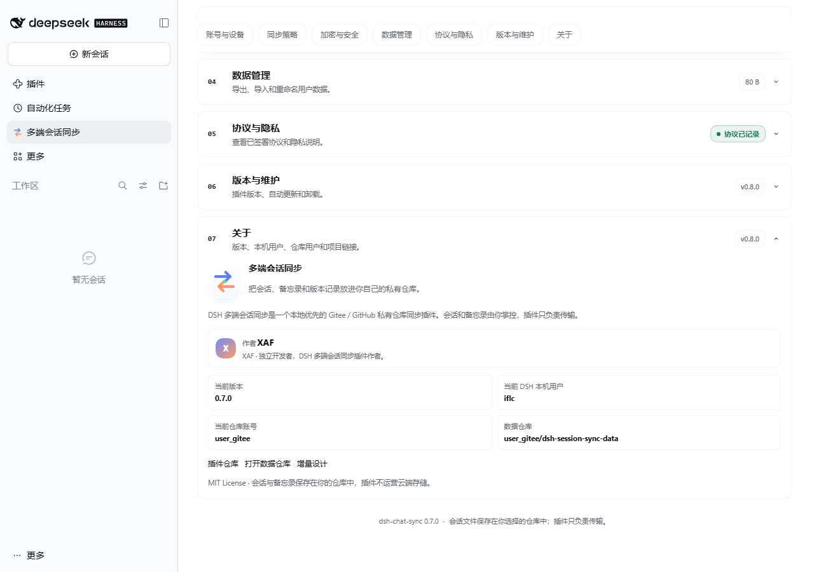
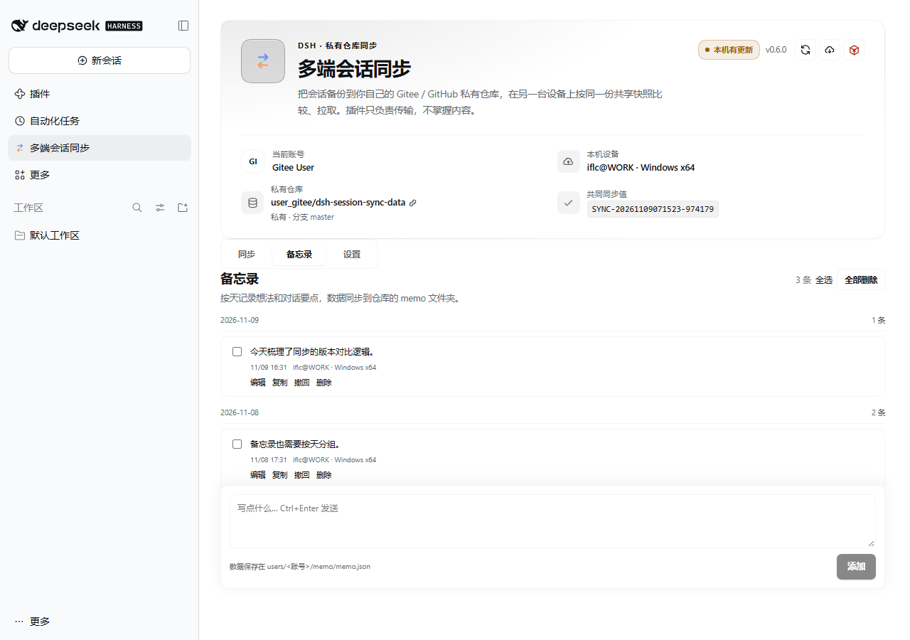

<div align="center">


# DSH 多端会话同步助手

**把会话和备忘录，放进只属于你自己的私有仓库。**

Gitee / GitHub 自选 · 覆盖与增量 · 智能同步 · AES-256 · Git 版本记录 · 备忘录时间线

<code>v0.15.0</code> · <code>AGPL-3.0</code> · <code>Windows / macOS / Linux</code>

[快速开始](#快速开始) · [功能亮点](#功能亮点) · [开发者说明](docs/readme.md) · [开发文档](docs/develop-readme.md)

</div>

---

## 一句话

DSH 会产生会话。你换一台电脑、重装一次系统、或者只是想留一份自己的记录时，会话不应该被困在某一台机器里。

**DSH 多端会话同步助手**把会话打包，写进你自己的 Gitee / GitHub **私有仓库**。插件只做搬运，不运营云端，不收集内容，不碰你的账号密码。

> 你的仓库，你的数据，你的版本历史。

---

## 功能亮点

|  |  |
|---|---|
| **私有仓库优先** | Gitee / GitHub 任选；登录后自动创建或复用私有仓库；公开仓库会被拒绝同步。 |
| **附件随行** | 推送时把会话引用的图片等附件一起打包；拉取时写入本机附件库；缺失的引用自动替换为占位文本；独立的「修改会话」标签页可先扫描、确认后再修复历史会话。 |
| **两条同步路径** | 推送：全选默认覆盖公共快照，也可选增量合并；未全选会自动切到增量。拉取：默认增量补齐，也可强制覆盖本机（先备份）。 |
| **更新即重启** | 插件自更新后可直接点「立即重启 DSH」；宿主不支持时退回手动重启提示，检测到新宿主后页面自动刷新。 |
| **登记修复** | 「修改会话」页可扫描并修复「文件在、侧栏看不到」的会话：按会话头的工作目录补登记，并清理损坏时期生成的投影缓存。 |
| **选择性下载** | 下载更新或历史版本时弹出会话选择器：按工作区分组、默认全选、可整组开关，只写回勾选的会话。 |
| **历史版本** | 同步页可加载仓库最近 3 次快照（含版本号、设备、会话数），按增量或强制方式下载回本机。 |
| **增量无需先拉** | 增量推送/拉取都是双向合并，可以直接执行；只有「强制覆盖」才要求先拉取到最新，避免替换掉别的设备写入的内容。 |
| **先拉后推** | 仓库已有新版本时，推送会被拦下并要求先增量拉取，避免把别的设备的记录冲掉。 |
| **智能同步** | 默认开启；连续两次 3 小时定时检查无变化后自动暂停，下次打开或会话完成时恢复。 |
| **覆盖可回滚** | 覆盖前自动备份；设置里查看备份并恢复；覆盖前必须确认。 |
| **哪边最新** | 区分「仓库有更新 / 本机有更新 / 两边都有更新」，不再盲目提示。 |
| **Git 版本记录** | 每次写入都是 Git 提交；同步页可查看最近提交、作者、时间并打开对应记录。 |
| **备忘录时间线** | 独立标签页，按天记录；编辑、删除、撤回、复制、多选批量删除、全部删除。 |
| **多账号** | 保存多个 Gitee/GitHub 登录；退出、切换、切回、删除历史记录。 |
| **设备身份** | 12 位 MAC 作为唯一标识；用户名、计算机名、系统版本作为辅助；IP 只展示。 |
| **安全可控** | 同步包可选 AES-256-GCM；导出包强制加密；令牌只存本机。 |
| **可维护** | 检查更新、清空本机插件数据、初始化（保留登录）、一键卸载；都不动现有聊天。 |
| **作者** | XAF · 独立开发者 |

---

## 一张图看懂

<div align="center">



<br />



</div>

---

## 快速开始

### 1. 安装

**推荐：用安装包安装，不需要 git，也不需要任何 Gitee 账号。**

从本仓库下载 `dist/dsh-chat-syncer-0.15.0.tgz`（浏览器直接下载即可），然后：

```powershell
dsh plugin --profile desktop add "file:C:\Users\<you>\Downloads\dsh-chat-syncer-0.15.0.tgz"
```

也可以一行装完，让 DSH 自己下载安装包（走 HTTPS，不经过 git）：

```powershell
dsh plugin --profile desktop add "https://gitee.com/user_gitee/dsh-chat-sync/raw/master/dist/dsh-chat-syncer-0.15.0.tgz"
```

（如果你的 DSH 版本不接受 URL 规格，就先下载 `dist/dsh-chat-syncer-0.15.0.tgz`，再用上面的 `file:` 命令安装。）

其他方式：

```powershell
# 已解压的源码目录
dsh plugin --profile desktop add "file:D:\path\to\dsh-chat-syncer"

# 以 git 依赖安装：要求本机已安装 git；Gitee 的 git 通道可能返回 401 并要求登录
dsh plugin --profile desktop add https://gitee.com/user_gitee/dsh-chat-sync.git
```

安装后重启 DSH，左侧栏会出现 **多端会话同步助手**。

> 为什么默认不再用 git 地址：`dsh plugin add <git 地址>` 会让 pnpm 执行 `git ls-remote`，因此本机必须先装好 git；Gitee 对匿名 git 请求还可能直接返回 401（`reject by [gitee]`），git 会把 401 当成“需要认证”并弹出账号密码框。`.tgz` 安装包由 pnpm 通过 HTTPS 直接下载解包，这两步都能避开。

### 2. 登录

- 选择 **Gitee**（国内推荐）或 **GitHub**；
- 粘贴一个有仓库权限的个人访问令牌；
- 插件会自动创建或复用私有仓库 **`dsh-chat-syncer-data`**；旧名的 `dsh-chat-sync-data` 已存在时继续复用，不会另建。

### 3. 签署并同步

- 阅读并签署数据上传协议；
- 点「检查会话更新」查看仓库状态；
- 点「提交最新记录」选择会话；
- 默认全选，也可以只提交一个会话做冒烟测试。

在另一台机器拉取后，插件会把会话登记到会话头记录的工作区，直接出现在左侧栏。工作区目录在本机不存在时会自动补建（盘符根、系统目录等受保护位置除外）；建不出来的会列在提示里，可人工处理后点「重新登记」。

---

## 安全边界

- 插件不运营云端服务，不上传会话到作者服务器。
- 所有数据只写入你选择的私有仓库。
- 令牌只保存在本机；不会写入仓库，也不会返回给网页。
- 同步包默认不加密，可在设置中开启 AES-256-GCM。
- 导出包始终强制加密，导入必须输入口令。
- Git 历史不会因为删除最新文件而自动消失；敏感内容请使用加密。
- 仓库必须保持私有；公开仓库会被拒绝。

---

## 开发者入口

| 文档 | 内容 |
|---|---|
| [开发入口](develop/README.md) | 开发资料地图、本地开发、核心约束 |
| [插件语言规范](develop/language-spec.md) | 术语、UI 文案、代码命名、提交和文档规范 |
| [开发者项目说明](docs/readme.md) | 项目定位、功能、架构、安装、同步模型和安全边界 |
| [开发文档](docs/develop-readme.md) | 源码结构、HTTP 接口、数据格式、同步流程、测试和发布 |
| [增量同步设计](docs/INCREMENTAL.md) | 当前语义增量与未来对象级增量方案 |

```text
index.js              Host 入口：路由、会话事件、自动提交
client.js             Web 客户端：登录、同步、设置、备忘录
lib/service.js        同步服务：状态机、推送/拉取、账号、维护
lib/provider.js       Gitee / GitHub REST 适配器
lib/bundle.js         .dsync 包：tar.gz + 可选 AES
lib/crypto.js         AES-256-GCM / scrypt
lib/sessions.js       DSH 会话扫描与写入
lib/data-readme.js    数据仓库 README 模板
lib/update.js         Gitee 插件更新
```

---

<div align="center">

**DSH 多端会话同步助手**

作者：**XAF** · License：**AGPL-3.0-only**

[插件仓库](https://gitee.com/user_gitee/dsh-chat-sync) · [数据仓库](https://gitee.com/user_gitee/dsh-chat-sync-data) · [问题反馈](https://gitee.com/user_gitee/dsh-chat-sync/issues)

</div>
